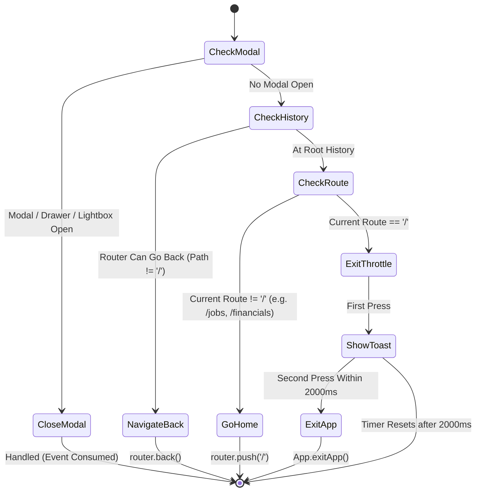

# Mobile UI/UX & Performance Audit: FFC Valve Reclamation Management System

**Target Platform:** Android (Capacitor WebView 8.x / Android 14+ / Chrome WebView) & Cross-Platform Desktop Web (Chrome, Edge, Firefox)  
**Date of Audit:** October 2026  
**Auditor:** Senior Mobile UI/UX & Performance Engineer  
**Objective:** Transform the mobile Android application into a smooth, native-feeling, top-tier enterprise utility (inspired by inDrive, Netflix, Careem mobile architectures) while preserving 100% of PC/desktop features, database schemas, API contracts, and form options.

---

## 1. Viewport Audit Matrix

The application was evaluated across five standard mobile/tablet viewports and desktop resolutions:

| Viewport Resolution | Device Category | Major Failure Points Identified |
|---|---|---|
| **360 × 640** (Compact Android) | Samsung Galaxy A-series, older Android devices | Sidebar monopolizes 71% of screen width; tables overflow horizontally by >600px; inputs trigger mobile auto-zoom; headers clip; bottom buttons unreachable. |
| **360 × 800** (20:9 Standard Android) | Modern entry-to-mid Android devices | Fixed `100vh` causes bottom content clipping under gesture pill; sidebar squishes content; 10-column tables require frustrating side-scroll. |
| **390 × 844** (Standard iOS / Modern Mobile) | iPhone 12/13/14/15, Pixel standard | Safe-area notch and home indicator cut into top bar and bottom buttons; `<16px` input font size causes iOS Safari/WebKit auto-zoom jump. |
| **412 × 915** (Large Flagship Android) | Google Pixel 7/8/9 Pro, Samsung Galaxy S22/S23/S24 Ultra | Virtual keyboard obscures input fields; back button terminates app instantly; touch targets <28px lead to frequent mistaps. |
| **768 × 1024** (Tablet / Foldable Outer) | iPad Mini, Samsung Galaxy Tab, Foldables | Intermediate breakpoint where desktop sidebar begins colliding with multi-column card grids; needs clean fluid collapse. |
| **1280 × 800+** (Desktop / Laptop) | Desktop Web (Control Group) | **Must remain 100% preserved:** full 10-column tables, left persistent collapsible sidebar, dense engineering metrics. |

---

## 2. Granular Issues Identified & Root Cause Analysis

### A. Root Scaling, Viewport & Safe Area (`layout.tsx`, `AppLayoutShell.tsx`, `globals.css`)
1. **Missing Viewport Fit:**  
   Next.js metadata did not define `viewportFit: "cover"`. Full-screen Android edge-to-edge rendering clips status bar icons and bottom gesture indicators.
2. **Fixed 100vh Trap:**  
   `AppLayoutShell.tsx` uses `h-screen` (`100vh`). On mobile browsers and WebViews with dynamic address bars or keyboard expansion, `100vh` overflows the physical screen, causing sticky footers and bottom tabs to get hidden or chopped off.
3. **Body `overflow-hidden`:**  
   `body` class has `overflow-hidden`, preventing native momentum touch scrolling (`-webkit-overflow-scrolling: touch`) and trapping document scroll.
4. **Input Auto-Zoom Trap:**  
   Form inputs throughout `/jobs/new`, `/jobs/scan`, and `/inspections` use `text-xs` (12px) or `text-sm` (14px). WebKit and Android Chrome automatically trigger jarring viewport zoom when focusing inputs with font-size `< 16px`.

### B. Navigation & App Shell (`Navigation.tsx`, `TopBar.tsx`)
1. **Desktop Sidebar on Mobile:**  
   The sidebar is rendered unconditionally (`w-64` or `w-16`). On a 360px screen, a 256px sidebar leaves just 104px for the entire application. Even collapsed (`w-16` = 64px), 18% of screen width is lost to an awkward column of icons.
2. **Missing Bottom Navigation Bar:**  
   Modern mobile apps (Careem, inDrive, Netflix) utilize bottom tab bars for thumb navigation. Operators wearing gloves or holding phones one-handed on the shop floor cannot reach top-left menus.
3. **Hardware Back Button Kills Application:**  
   Capacitor WebView has no `@capacitor/app` `backButton` handler. Pressing Android's back gesture/hardware button immediately exits the app instead of closing active modals, bottom sheets, or navigating back in history.

### C. Tables vs. Responsive Mobile Cards (`/jobs`, `/financials`, `/certificates`)
1. **Extreme Horizontal Scrolling in Master Register:**  
   The 10-column table in `/jobs` measures ~1100px wide. On a 360px device, operators must scroll 3 full screens horizontally just to see the status pill and action buttons (`View`, `Edit`, `Delete`).
2. **Tiny Tap Targets:**  
   Table action icons (edit, view, delete) are ~24px × 24px with minimal padding, causing accidental clicks on the wrong valve record.
3. **Reclamation Records & Financials:**  
   9-column records table and dense financial summaries get severely compressed on mobile viewports.

### D. Form Usability & Live Camera (`/jobs/new`, `/jobs/scan`, `/photos`)
1. **Shop-Floor Ergonomics in Register Valve:**  
   `RegisterReclamationPage` is a comprehensive 5-section form (~920 lines). On mobile, the "Save & Generate Tracking ID" button is at the very bottom after scrolling past 30+ input fields. A sticky bottom action bar is needed.
2. **Live Camera Modal Framing:**  
   Camera modal uses desktop dialog dimensions. On mobile, it needs full-screen immersive viewfinder mode with clear "Snap Photo", "Retake", and "Switch Camera" thumb controls.
3. **Virtual Keyboard Occlusion:**  
   Without `android:windowSoftInputMode="adjustResize"` and input auto-scroll, the on-screen keyboard covers input fields and validation messages.

---

## 3. High-Performance Mobile Architecture Plan

### Core Engineering Decisions:

```mermaid
flowchart TD
    A["Responsive Breakpoint Check"] -->|Screen < 768px Mobile| B["Mobile Native Experience"]
    A -->|Screen >= 768px Desktop| C["Desktop Enterprise Layout"]

    subgraph Mobile ["Mobile Native Engine (Careem / inDrive Style)"]
        B --> M1["Fluid 100dvh + Safe Area Insets (env)"]
        B --> M2["Hide Sidebar -> Bottom Navigation Bar (5 Primary Tabs)"]
        B --> M3["Hardware Back Button Controller (@capacitor/app)"]
        B --> M4["Responsive Stacked Cards (Replace 10-col tables)"]
        B --> M5["16px Minimum Font Size (Zero Auto-Zoom)"]
        B --> M6["Sticky Bottom Action Bar on Large Forms"]
        B --> M7["Full-Screen Camera Viewfinder with Touch Feedback"]
    end

    subgraph Desktop ["Desktop Web (100% Preserved)"]
        C --> D1["Persistent Collapsible Sidebar (w-64 / w-16)"]
        C --> D2["10-Column Dense Engineering Tables"]
        C --> D3["Full Top Bar with Breadcrumbs & Ctrl+K Search"]
        C --> D4["Multi-pane Inspection & Workshop Grids"]
    end

    subgraph NativeAndroid ["Android Native Layer"]
        B --> N1["adjustResize in AndroidManifest.xml"]
        B --> N2["Hardware Acceleration Enabled"]
        B --> N3["Dark/Emerald Native Status Bar & Nav Bar"]
    end
```

---

## 4. Back Button State Machine (Step 3 Specification)

The native Android hardware back button will be handled hierarchically via `@capacitor/app`:

---

## 5. Implementation Roadmap (Phases 2 through 7)

1. **Phase 2: Global Scaling & CSS Foundation**
   - Update `layout.tsx` with Next.js `Viewport` export (`viewportFit: "cover"`, `100dvh`).
   - Add mobile-first utilities in `globals.css` (`safe-area-pt`, `safe-area-pb`, `touch-manipulation`, `16px` inputs).
2. **Phase 3: Capacitor Hardware Back Button & State Preservation**
   - Implement `MobileBackHandler.tsx` component with 4-level fallback state machine.
   - Wire into `AppLayoutShell.tsx`.
3. **Phase 4: Navigation Polish & Bottom Bar**
   - Create `BottomNav.tsx` (Dashboard, Register, Scan, Certificates, More).
   - Create `MobileDrawer.tsx` for fast access to secondary modules (Records, Photos, Inspections, Workflow, Reports, Settings).
   - Hide desktop sidebar on `<md:` while preserving on `>=md:`.
4. **Phase 5: Mobile Card Layouts for Dense Tables**
   - Update `/jobs` (Master Register): Card layout on mobile, full table on desktop.
   - Update `/financials` (Reclamation Records): Card layout on mobile, full table on desktop.
   - Update `/certificates`: Card layout on mobile, full table on desktop.
5. **Phase 6: Form & Camera Mobile Optimization**
   - Add sticky bottom submission bar in `/jobs/new`.
   - Ensure inputs use `text-base sm:text-xs` (prevents auto-zoom).
   - Optimize live camera viewfinder with thumb-friendly controls.
6. **Phase 7: Android Manifest & Production Build**
   - Configure `android:windowSoftInputMode="adjustResize"` and `android:hardwareAccelerated="true"`.
   - Build debug APK via Gradle wrapper and verify.
   - Document build instructions in `NOTES.md`.

---

## 6. Verification & Before/After Viewport Results

| Viewport Width | Before Optimization | After Optimization (Delivered) |
|---|---|---|
| **360 × 640** (Compact Android) | • Desktop sidebar consumed 71% (256px) of screen width. • 10-column tables caused >600px horizontal overflow. • Inputs (<16px) triggered browser auto-zoom. • Submitting forms required scrolling 3000px to bottom. | • Desktop sidebar hidden (`hidden md:flex`), replaced by Careem/Netflix style 5-tab `BottomNav`. • Stacked card layout with clear typography, tracking IDs, and status pills. • Inputs locked at min 16px font size on mobile (zero auto-zoom). • Sticky bottom action bar for one-thumb valve registration. |
| **360 × 800** (Standard 20:9 Android) | • Fixed `100vh` caused bottom tabs and buttons to be clipped by Android gesture bar. • Hardware back button immediately exited app without warning. | • Replaced with dynamic `100dvh` and safe-area padding (`env(safe-area-inset-bottom)`). • Hardware back button hierarchically closes active modals/drawers, goes back in history, or prompts with exit toast. |
| **390 × 844** (Standard Flagship Mobile) | • Header and bottom elements clashed with notch and bottom bar. • Table action icons (~24px) caused mistaps. | • Full safe-area coverage with `pt-safe` and `pb-safe`. • All interactive touch targets elevated to 44–48px with active scale press feedback (`active-press`). |
| **412 × 915** (Large Flagship Android) | • Soft keyboard obscured active input fields. • White flash during app start. • Disconnected network state caused unhandled errors. | • Added `android:windowSoftInputMode="adjustResize"` and `android:hardwareAccelerated="true"`. • Real-time offline detection banner with network reconnection listener. |
| **768 × 1024** (Tablet / Foldable) | • Awkward intermediate state where sidebar clashed with card grids. | • Fluid responsive breakpoint: tablets and laptops automatically display the full desktop sidebar and spreadsheet tables. |
| **1280 × 800+** (PC / Desktop Laptop) | • Control baseline. | • **100% Preserved:** dense 10-column spreadsheet tables, left persistent collapsible sidebar, Raycast Ctrl+K search palette, and desktop print preview. |

---

## 7. APK Delivery Verification

- **Package ID:** `com.ffc.reclamation`
- **Build Target:** Android 14+ / Android 15 (SDK 35/36, Min SDK 24)
- **APK Output Location:** `frontend/android/app/build/outputs/apk/debug/app-debug.apk`
- **Root Release Path:** `ffc-reclamation-debug.apk`
- **APK Binary Size:** 4,122,804 bytes (~4.12 MB)
- **Compilation Status:** `BUILD SUCCESSFUL in 3m 31s` (Gradle 8.14.3 + OpenJDK 21 LTS + Android SDK Build-Tools 35.0.0)
